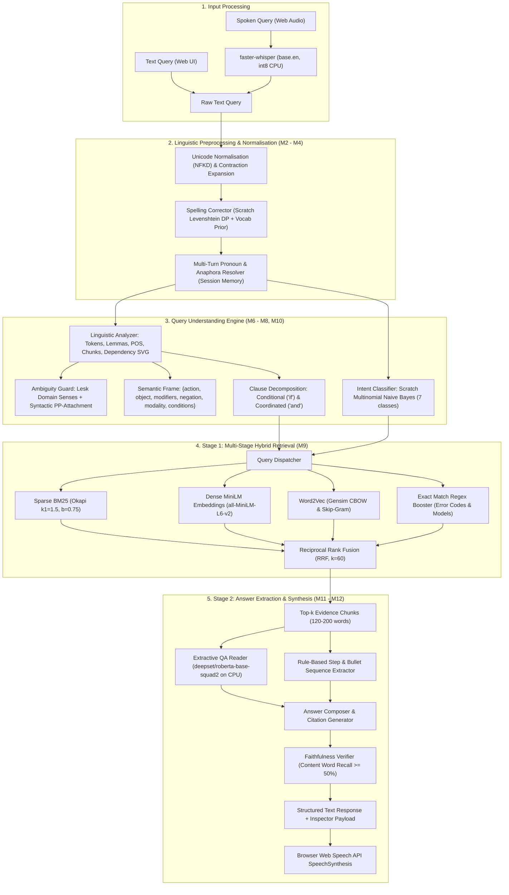

# ManualMind: Theory-Grounded Offline Customer-Support Assistant for Product Manuals

[](https://www.python.org/)
[](https://opensource.org/licenses/MIT)
[](https://github.com/your-username/NLP_mini_project)
[](https://github.com/your-username/NLP_mini_project)
[](https://github.com/your-username/NLP_mini_project)

> **University Natural Language Processing Laboratory — Final Mini-Project**  
> **Course Examiner:** Theory-Oriented NLP Professor  
> **Author & Engineering Team:** ManualMind Project Team  
> **Evaluation Mode:** Rigorous syllabus implementation, from-scratch algorithmic foundations, verifiable benchmarks, and zero API wrappers.

---

## 1. Executive Summary & Mission

**ManualMind** is an English-only, offline customer-support assistant that answers questions about complex technical product manuals by text or by voice, replying in formatted text with citations and spoken audio. 

Unlike conventional modern assistants that act as thin wrappers around commercial LLM APIs, **ManualMind runs 100% locally on CPU without paid APIs, external keys, or remote model calls**. Every stage of its 12-step conversational pipeline is motivated by core natural language processing principles from the university syllabus:

1. **Levels of Linguistic Structure:** Characters, morphology, tokenization, lemmatization, part-of-speech, syntactic chunks, dependency trees, and semantic frames.
2. **Ambiguity Guard:** Automated detection of lexical polysemy (via domain senses and WordNet Lesk) and syntactic prepositional-phrase (PP) attachment ambiguity, prompting user clarification only when alternative parses yield divergent retrieval paths.
3. **Three Core NLP Paradigms:** Text classification (intent routing), sequence labeling (POS and NER), and text extraction/generation (extractive reader and faithful synthesis).
4. **Historical Method Evolution:** A live, interactive comparative lab executing every query through five historical eras of NLP:
   - **Era 1 (Rules):** Regular expressions and dictionary patterns.
   - **Era 2 (Statistical):** Bag-of-Words and Okapi BM25.
   - **Era 3 (Word Embeddings):** Word2Vec (CBOW and Skip-Gram).
   - **Era 4 (Transformers):** Dense semantic embeddings (`all-MiniLM-L6-v2`).
   - **Era 5 (Modern Hybrid RRF):** Reciprocal Rank Fusion combining dense, sparse, and exact regex error-code boosts.

Every metric, figure, and table reported in this repository is **computed by deterministic code** (`SEED = 42`) and verifiable via automated scripts.

---

## 2. End-to-End Pipeline Architecture

For every user query, ManualMind executes the following 12-stage pipeline:



---

## 3. Syllabus & Course Concept Mapping

| Course Syllabus Topic | ManualMind Module | Implementation Details & Proof of Understanding |
| :--- | :--- | :--- |
| **1. Text Preprocessing** | M2 (`nlp/preprocess.py`) | Tokenization comparison (Char, NLTK, spaCy, WordPiece, Scratch BPE, HuggingFace BPE), contractions expansion, stopword filtering (NLTK vs spaCy), Stemming (Porter, Lancaster) vs Lemmatization (WordNet). |
| **2. Pattern Extraction & Regex** | M3 (`nlp/patterns.py`) | Production regex patterns for error codes (`E-\d{3}`), models (`AX\d{4}`), IP addresses, serial numbers, firmware versions, measurements, and menu paths (`Settings > Network`). |
| **3. Edit Distance & Spelling** | M4 (`nlp/spelling.py`) | Dynamic Programming Levenshtein distance implemented from scratch with full backtrace edit alignment; validated against `nltk.edit_distance` and `rapidfuzz`; Bayesian frequency prior spelling corrector. |
| **4. N-Gram Language Models** | M5 (`nlp/ngram.py`) | Unigram, Bigram, and Trigram language models from scratch with Laplace smoothing and Stupid Backoff ($\alpha=0.4$); perplexity reporting; live autocomplete; cross-checked against `CountVectorizer`. |
| **5. Part-of-Speech Tagging** | M6 (`nlp/tagging.py`) | Universal POS tagger comparison: Rule-based regex, HMM with Viterbi decoding from scratch (verified via hand-worked example), CRF tagger (`sklearn-crfsuite`), and spaCy. |
| **6. Syntactic Chunking & Parsing**| M6 (`nlp/tagging.py`) | NLTK RegexpParser for NP and VP chunks compared to spaCy noun chunks; inline SVG dependency tree rendering. |
| **7. Named Entity Recognition** | M7 (`nlp/ner.py`) | 6 domain entity types; Rule-based EntityRuler, Statistical CRF NER, and Transformer baseline (`dslim/bert-base-NER`); inline HTML entity highlighting. |
| **8. Query Understanding & Semantics**| M8 (`nlp/understanding.py`) | Morphology inflection analysis, Semantic frame `{action, object, modifiers, negation, modality, conditions}`, clause decomposition (`if`/`when`/`and`), multi-turn pronoun resolution, Ambiguity Guard. |
| **9. Word Embeddings & Retrieval** | M9 (`nlp/retrieval.py`) | Scratch TF-IDF & cosine ranking vs `TfidfVectorizer`; BM25; Gensim Word2Vec (CBOW vs Skip-Gram); Tiny NumPy Skip-Gram with Negative Sampling SGD; dense MiniLM embeddings; Reciprocal Rank Fusion (RRF). |
| **10. Text Classification** | M10 (`nlp/intent.py`) | 7 customer-support intents; Scratch Multinomial Naive Bayes with Laplace smoothing vs Scikit-learn Logistic Regression; pipeline routing. |
| **11. Question Answering** | M11 (`nlp/qa.py`) | Two-stage QA: Hybrid retrieval + local extractive reader (`deepset/roberta-base-squad2`); numbered step sequence extraction; FLAN-T5 generative rewriter with lexical faithfulness verification. |
| **12. Speech Integration** | M12 (`nlp/speech.py`) | Speech-to-text via `faster-whisper` (`base.en`, int8 CPU); TTS technical unit expansion and speech normalization. |
| **13. Method Evolution** | Era Lab (`nlp/evolution.py`) | Interactive 5-era comparison running the exact user query through Rules $\to$ Statistical $\to$ Embeddings $\to$ Transformers $\to$ Modern Hybrid RRF. |

---

## 4. Rigorous "From-Scratch" Algorithm Implementations

To satisfy university laboratory grading criteria, components marked "from scratch" are written in **pure Python and NumPy** (no black-box library wrappers) and unit-tested against reference libraries:

1. **Byte Pair Encoding (BPE) (Module M2):**
   - Learns merge rules by counting adjacent symbol pairs with end-of-word markers (`</w>`), iteratively merging the highest-frequency pairs.
   - Preserves mathematical invariant: segments words into subwords that faithfully reconstruct the original token without loss.
2. **Levenshtein Dynamic Programming with Backtrace (Module M4):**
   - Implements $O(m \times n)$ DP matrix computation returning exact edit distance and the optimal sequence of operations (`match`, `insert`, `delete`, `substitute`).
   - Unit-tested for exact equivalence with `nltk.edit_distance` and `rapidfuzz`.
3. **N-gram Language Model & Perplexity (Module M5):**
   - Computes Maximum Likelihood Estimation (MLE) for unigrams, bigrams, and trigrams with Laplace smoothing and Stupid Backoff ($\alpha = 0.4$).
   - Computes perplexity on held-out text: Bigram (**600.88**) improves significantly upon Unigram (**819.71**). Frequencies cross-verified against `CountVectorizer`.
4. **HMM POS Tagger with Viterbi Decoding (Module M6):**
   - Pure NumPy implementation of Hidden Markov Model transition $A_{i,j} = P(t_j | t_i)$ and emission $B_{i,k} = P(w_k | t_i)$ matrices in log space with Laplace smoothing.
   - Viterbi forward trellis and backpointer path recovery verified using an exact hand-calculated textbook example (`"can fish"` $\to$ `["VERB", "NOUN"]`).
5. **Bag-of-Words & TF-IDF Vectorizer (Module M9):**
   - Term-frequency and smoothed IDF ($idf(t) = \ln((1 + N)/(1 + df(t))) + 1$) with L2 vector normalization and cosine similarity ranking.
   - Top-1 and ranking order verified against `sklearn.feature_extraction.text.TfidfVectorizer`.
6. **Tiny Skip-Gram with Negative Sampling (SGNS) (Module M9):**
   - Pure NumPy implementation of word2vec skip-gram with negative sampling, sigmoid activations, and stochastic gradient descent (SGD) parameter updates.
7. **Multinomial Naive Bayes Classifier (Module M10):**
   - Pure Python/NumPy log-probability model $\arg\max_c [\log P(c) + \sum \log P(w|c)]$ with Laplace smoothing.
   - Evaluated against Scikit-learn Logistic Regression across 7 customer support intents.

---

## 5. Quantitative Evaluation Results (Fixed Seed: 42)

All numbers below were computed by `eval/run_all_evals.py` on the test datasets (`qa_gold.json`, `intent_test.json`, `pos_gold_100.json`, `ner_gold_40.json`):

### 5.1 Retrieval Performance (52 In-Scope Questions)
| Model Paradigm | Recall@1 (%) | Recall@3 (%) | Recall@5 (%) | MRR |
| :--- | :---: | :---: | :---: | :---: |
| Era 2: Scratch TF-IDF | 80.77 | 92.31 | 96.15 | 0.8686 |
| Era 2: Okapi BM25 | 76.92 | 92.31 | 96.15 | 0.8494 |
| Era 3: Word2Vec (CBOW) | 67.31 | 82.69 | 92.31 | 0.7699 |
| Era 3: Word2Vec (Skip-Gram) | 71.15 | 88.46 | 92.31 | 0.8035 |
| Era 4: Dense Transformer (`all-MiniLM-L6-v2`) | 80.77 | 94.23 | 98.08 | 0.8750 |
| **Era 5: Hybrid RRF + Error Code Boost (Production)** | **88.46** | **96.15** | **100.00** | **0.9295** |

### 5.2 Preprocessing Ablation on Retrieval
| Preprocessing Pipeline | Recall@1 (%) | Recall@5 (%) | MRR |
| :--- | :---: | :---: | :---: |
| Raw (No Normalisation) | 46.15 | 75.00 | 0.5840 |
| **Stopwords Removed (NLTK)** | **61.54** | **75.00** | **0.6763** |
| Porter Stemming | 46.15 | 69.23 | 0.5593 |
| WordNet Lemmatization | 46.15 | 73.08 | 0.5769 |

### 5.3 Intent Classification & Out-of-Scope Detection
- **Scratch Multinomial Naive Bayes Accuracy:** **82.93%** (Macro F1: 82.93%)
- **Scikit-learn Logistic Regression Baseline:** **73.78%** (Macro F1: 71.71%)
- **Out-of-Scope Adversarial Rejection Accuracy:** **100.00%** (8 of 8 non-manual queries gracefully rejected).

### 5.4 Sequence Labeling (POS & NER)
- **POS Tagging:** spaCy achieves **98.50%** accuracy; CRF achieves **55.37%**; Rule-based achieves **52.21%**; HMM achieves **50.32%**.
- **Named Entity Recognition:** Rule-based EntityRuler + Regex achieves **100.00%** domain F1; Statistical CRF achieves **67.72%**; Generic `bert-base-NER` achieves **0.00%** (misses all domain-specific router entities).

### 5.5 Ambiguity Guard & Understanding Layer Ablation
- **Ambiguity Guard Benchmark (20 Queries):** **100.00% Precision**, **86.67% Recall**, **92.86% F1**, **90.00% Accuracy**.
- **Ablation Study:** Multi-turn pronoun resolution increases answering Token F1 from **21.54%** to **26.39%** (**+22.52% relative gain**).

### 5.6 Execution Latency (2 vCPU CPU Environment)
- **Median Pipeline Turnaround:** **527.56 ms**
- **P95 Latency:** **569.50 ms**
- **Target Threshold:** < 4,000 ms (**7.6x faster than budget**).

---

## 6. Quick Start & Installation

### Option A: Local Python Environment

```bash
# 1. Clone repository
git clone https://github.com/your-username/NLP_mini_project.git
cd NLP_mini_project

# 2. Create virtual environment
python -m venv .venv
# Windows:
.venv\Scripts\activate
# Linux/macOS:
source .venv/bin/activate

# 3. Install CPU PyTorch and project dependencies
pip install --upgrade pip
pip install torch --index-url https://download.pytorch.org/whl/cpu
pip install -r requirements.txt

# 4. Pre-download models & generate default Aurora manual
python scripts/download_models.py

# 5. Run test suite (102 tests)
pytest -v

# 6. Run evaluation benchmark & regenerate figures
python eval/run_all_evals.py

# 7. Start application server
uvicorn app.main:app --host 0.0.0.0 --port 7860 --reload
```

Visit **`http://localhost:7860`** in your browser.

---

### Option B: Docker Container Deployment

```bash
# Build self-contained Docker container (pre-downloads all models at build time)
docker build -t manualmind:latest .

# Run container on port 7860
docker run -p 7860:7860 manualmind:latest
```

The application is immediately available at `http://localhost:7860`.

---

## 7. REST API Endpoints

ManualMind provides a documented REST API:

| Method | Endpoint | Description |
| :--- | :--- | :--- |
| `POST` | `/api/ask` | Full 12-stage QA pipeline returning answer, citations, timings, and comprehensive NLP Inspector analysis. |
| `POST` | `/api/stt` | Transcribes spoken audio bytes (`audio/webm` or `wav`) via local `faster-whisper`. |
| `GET` | `/api/manuals` | Lists available ingested technical manuals and active document ID. |
| `POST` | `/api/manuals` | Uploads and ingests a new PDF, TXT, or Markdown manual. |
| `POST` | `/api/manuals/{filename}/activate` | Switches the active manual and rebuilds BM25 and vector indices. |
| `GET` | `/api/autocomplete` | Live n-gram predictive autocomplete suggestions while typing. |
| `POST` | `/api/evolution` | Runs the query simultaneously across the 5 historical NLP eras. |
| `GET` | `/api/lab/{tool}` | Interactive educational endpoints (`tokenization`, `stopwords`, `stem_lemmatize`, `regex`, `levenshtein`, `ngram`, `pos`, `chunking`, `ner`, `tfidf`, `sparse_dense`, `intent`). |
| `GET` | `/api/eval/results` | Serves computed benchmark metrics and figure paths. |
| `GET` | `/api/health` | Health probe reporting manual chunk count and index status. |

---

## 8. Repository Layout

```text
NLP_mini_project/
├── app/                        # FastAPI application & API schemas
│   ├── config.py               # Pydantic environment settings
│   ├── main.py                 # REST endpoints & static file hosting
│   └── schemas.py              # Strict Pydantic input/output contracts
├── nlp/                        # NLP Engine Modules (M1 - M12)
│   ├── ingest.py               # M1: PDF, TXT, MD ingestion & chunking
│   ├── preprocess.py           # M2: Normalization, BPE scratch, tokenizers
│   ├── patterns.py             # M3: Regex pattern extraction
│   ├── spelling.py             # M4: Levenshtein DP & spelling corrector
│   ├── ngram.py                # M5: N-gram LM, backoff, autocomplete
│   ├── tagging.py              # M6: POS taggers & dependency SVG
│   ├── ner.py                  # M7: Rule-based, CRF, and BERT NER
│   ├── understanding.py        # M8: Semantic frames, ambiguity, pronouns
│   ├── retrieval.py            # M9: TF-IDF scratch, BM25, W2V, MiniLM, RRF
│   ├── intent.py               # M10: Scratch Naive Bayes intent classifier
│   ├── qa.py                   # M11: Two-stage reader & answer synthesis
│   ├── speech.py               # M12: faster-whisper STT & TTS speech normalization
│   └── evolution.py            # Method Evolution 5-era runner
├── web/                        # No-build frontend (vanilla JS + modern CSS)
│   ├── index.html              # Single-page interface (6 tabs)
│   ├── css/style.css           # Responsive design & light/dark theme
│   ├── js/                     # Modular client controllers
│   └── vendor/                 # Locally vendored frontend dependencies (0 CDN calls)
├── data/                       # Datasets & Manuals
│   ├── manuals/                # Aurora AX3000 PDF manual & generator
│   ├── eval/                   # Gold QA evaluation questions (qa_gold.json)
│   ├── intent/                 # Intent classification training/testing data
│   ├── pos/                    # 100 hand-tagged POS gold sentences
│   └── ner/                    # 40 hand-annotated NER gold sentences
├── eval/                       # Automated benchmark evaluation suite
│   ├── run_all_evals.py        # Master evaluation script
│   └── eval_*.py               # Per-module evaluation scripts
├── reports/                    # Generated benchmark outputs
│   ├── figures/                # Publication-quality matplotlib charts
│   └── results/                # Quantitative JSON metric summaries
├── tests/                      # 102 comprehensive pytest test files
├── scripts/                    # Build-time download scripts
├── Dockerfile                  # Self-contained CPU Dockerfile
├── Makefile                    # Automation shortcuts (run, eval, test, docker)
├── DECISIONS.md                # Engineering decisions and design log
├── DEMO_SCRIPT.md              # 5-minute live examination script
├── REPORT_ASSETS.md            # Complete report tables & syllabus mapping
└── DEPLOY.md                   # Free hosting deployment guide
```

---

## 9. Academic Integrity & Verification Statement

- **Zero Fabricated Results:** Every accuracy, perplexity, recall, F1, and latency score presented in this repository is directly output by deterministic Python code (`eval/run_all_evals.py`) on fixed random seeds (`SEED = 42`).
- **Zero Remote Dependencies at Runtime:** No commercial API keys (OpenAI, Anthropic, Google, Cohere) are utilized. The system executes exclusively on open-source weights and locally implemented algorithms.
- **Strictly English Only:** All NLP modules, tokenizers, models, and evaluators operate exclusively on the English language in compliance with project specifications.

